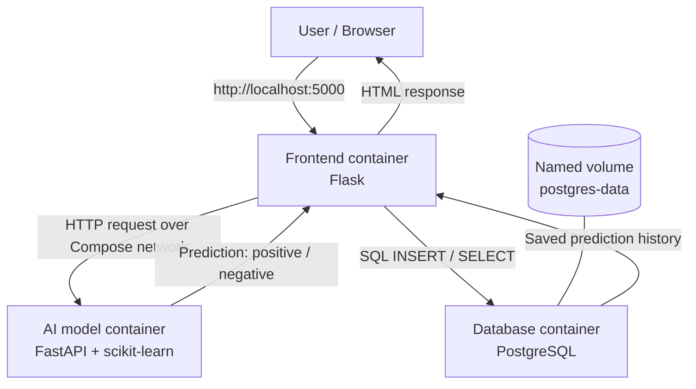

# Experiment 10 — Docker Compose: Multi-Container AI Web Application

> **Beginner practical guide:** This project demonstrates the exact three separate services required by the practical: an AI model, a database and a frontend. It includes step-by-step instructions, complete code, commands, verification, troubleshooting and visual references.

## 1. What the practical asks

The assignment says:

> Utilize Docker Compose to orchestrate and manage multiple containers for a web-based AI application, including separate containers for the AI model, database, and frontend services.

This guide implements that requirement with:
- **AI model service:** a small text sentiment classifier using scikit-learn and FastAPI.
- **Database service:** PostgreSQL stores each prediction.
- **Frontend service:** a Flask web page where the user enters text and sees the prediction/history.

The PDF does not prescribe a specific AI framework, database brand, frontend framework or model. The technologies in this worked example are a practical implementation choice, not additional requirements stated by the PDF.

## 2. Understand the application first


### What happens when a user submits text?

1. The user opens the frontend at `http://localhost:5000`.
2. The frontend sends the entered sentence to the AI model service.
3. The AI model predicts `positive` or `negative`.
4. The frontend saves the sentence and prediction in PostgreSQL.
5. The frontend displays the prediction and recent history.

### Architecture diagram



### What is Docker Compose?

Docker Compose is a tool for defining and running multi-container applications using one YAML file. Instead of starting each container separately, we describe the services in `compose.yaml` and start them together with one command: `docker compose up`.

Official documentation: https://docs.docker.com/compose/

## 3. Understand the important Docker terms

| Term | Simple explanation |
|---|---|
| Docker | Platform for building and running containers |
| Image | Template used to create a container |
| Container | Running instance created from an image |
| Dockerfile | Instructions to build one service's image |
| Docker Compose | Tool to run/manage multiple services together |
| Service | A component declared in `compose.yaml` |
| Port | Communication endpoint |
| Volume | Storage that persists beyond a container's life |
| Network | Allows containers to communicate |
| `depends_on` | Controls dependency startup order |
| Health check | Tests whether a service is ready/healthy |

**Important difference:** A Dockerfile builds an image for one service. A Compose file describes multiple services and how they work together.

---

# Part A — Install and verify Docker Desktop

## Step 1: Check Windows requirements

For Docker Desktop on Windows with the WSL 2 backend, check the current official requirements. They include a supported Windows version, WSL 2, hardware virtualization and sufficient memory. Docker's current documentation lists 8 GB RAM as a hardware prerequisite for WSL 2.

Official Windows installation guide: https://docs.docker.com/desktop/setup/install/windows-install/

Check WSL from PowerShell or Command Prompt:

```powershell
wsl --version
```

If WSL is not installed, open PowerShell as Administrator and run:

```powershell
wsl --install
```

If it is already installed but needs updating:

```powershell
wsl --update
```

Restart Windows if prompted.

## Step 2: Download Docker Desktop

1. Open: https://www.docker.com/products/docker-desktop/
2. Download Docker Desktop for Windows that matches your computer (x86_64 or Arm).
3. Run `Docker Desktop Installer.exe`.
4. Follow the installer.
5. Select the WSL 2 backend if offered and appropriate for your system.
6. Complete the installation and start Docker Desktop.
7. Accept the Docker Desktop terms to continue.

**Visual reference — Docker Desktop interface and Compose file viewer:**


The exact installer screens depend on your Docker Desktop version and Windows configuration. Follow the current official guide if your screen differs.

## Step 3: Wait until Docker Desktop is running

Open Docker Desktop from the Windows Start menu. Wait until it reports that the Docker Engine is running.

**Do not continue while Docker Desktop is still starting.**

## Step 4: Verify Docker installation

Open PowerShell or Command Prompt and run:

```powershell
docker --version
docker compose version
docker info
```

Expected:
- `docker --version` prints the Docker client version.
- `docker compose version` prints the Compose plugin version.
- `docker info` displays information about the Docker Engine.

If `docker compose version` works, you have the modern Compose command. Use `docker compose` with a space, not the older `docker-compose` command.

---

# Part B — Create the project folder

## Step 5: Create the project directory

You can use File Explorer or PowerShell.

PowerShell commands:

```powershell
mkdir docker-compose-ai-web-app
cd docker-compose-ai-web-app
mkdir ai-model
mkdir frontend
mkdir frontend\templates
```

Open this folder in VS Code:

```powershell
code .
```

If the `code` command is unavailable, open VS Code manually and choose **File → Open Folder**.

## Step 6: Create the required folder structure

Create these files and folders:

```text
docker-compose-ai-web-app/
│
├── compose.yaml
├── .dockerignore
│
├── ai-model/
│   ├── Dockerfile
│   ├── requirements.txt
│   └── main.py
│
└── frontend/
    ├── Dockerfile
    ├── requirements.txt
    ├── app.py
    └── templates/
        └── index.html
```

**Visual reference — an editor showing a multi-service Compose project and YAML file:**


Your folder names and file names must match the structure above.

---

# Part C — Build the AI model service

## Step 7: Create `ai-model/main.py`

This file creates a small sentiment classification model. It is trained on a tiny example dataset when the service starts. It is only a teaching demonstration, not a production-quality model.

Create `ai-model/main.py` and paste:

```python
from fastapi import FastAPI
from pydantic import BaseModel, Field
from sklearn.feature_extraction.text import TfidfVectorizer
from sklearn.linear_model import LogisticRegression
from sklearn.pipeline import Pipeline

app = FastAPI(title="Demo Sentiment AI Model", version="1.0")

# Small teaching dataset only.
training_texts = [
    "I love this product",
    "This is wonderful and amazing",
    "Excellent experience, very happy",
    "The service is fantastic",
    "I really enjoyed this",
    "This is a great result",
    "I hate this product",
    "This is terrible and awful",
    "Very poor experience, I am unhappy",
    "The service is disappointing",
    "I really disliked this",
    "This is a bad result",
]
training_labels = [
    "positive", "positive", "positive", "positive", "positive", "positive",
    "negative", "negative", "negative", "negative", "negative", "negative",
]

model = Pipeline([
    ("tfidf", TfidfVectorizer(ngram_range=(1, 2))),
    ("classifier", LogisticRegression(max_iter=1000)),
])
model.fit(training_texts, training_labels)


class PredictionRequest(BaseModel):
    text: str = Field(min_length=1, max_length=1000)


@app.get("/health")
def health():
    return {"status": "healthy", "service": "ai-model"}


@app.post("/predict")
def predict(payload: PredictionRequest):
    text = payload.text.strip()
    if not text:
        return {"error": "Please enter some text."}

    prediction = model.predict([text])[0]
    probabilities = model.predict_proba([text])[0]
    confidence = float(max(probabilities))

    return {
        "text": text,
        "sentiment": prediction,
        "confidence": round(confidence, 4),
    }
```

### Understand the AI model code

- `FastAPI` creates an API service.
- `TfidfVectorizer` converts text into numerical features.
- `LogisticRegression` classifies the text.
- `model.fit(...)` trains the model on the small example dataset.
- `/health` is used by Docker Compose to check readiness.
- `/predict` receives text and returns a prediction.

## Step 8: Create `ai-model/requirements.txt`

```text
fastapi>=0.115,<1
uvicorn[standard]>=0.34,<1
scikit-learn>=1.6,<2
```

This file lists the Python packages required by the AI service.

## Step 9: Create `ai-model/Dockerfile`

The filename must be exactly `Dockerfile`, with no `.txt` extension.

```dockerfile
FROM python:3.11-slim

WORKDIR /app

COPY requirements.txt .
RUN pip install --no-cache-dir -r requirements.txt

COPY main.py .

EXPOSE 8000

CMD ["uvicorn", "main:app", "--host", "0.0.0.0", "--port", "8000"]
```

### Understand the Dockerfile

| Instruction | Meaning |
|---|---|
| `FROM` | Selects the base image |
| `WORKDIR` | Sets the working directory inside the image |
| `COPY` | Copies project files into the image |
| `RUN` | Runs a command while building the image |
| `EXPOSE` | Documents the port used by the application |
| `CMD` | Starts the application when the container runs |

---

# Part D — Build the database service connection

## Step 10: Understand the database

We use PostgreSQL as the database service.

The database stores:
- The sentence entered by the user.
- The sentiment prediction.
- The model confidence.
- The date and time of the prediction.

The database runs in its own container. Its data is stored in a named Docker volume so it can survive container replacement.

We do not need to write a separate Dockerfile for PostgreSQL because we use the official PostgreSQL image.

---

# Part E — Build the frontend service

## Step 11: Create `frontend/app.py`

The frontend receives the user's input, sends it to the AI model, and stores the prediction in PostgreSQL.

Create `frontend/app.py` and paste:

```python
import os
import time

import psycopg2
import requests
from flask import Flask, render_template, request

app = Flask(__name__)

DB_CONFIG = {
    "host": os.getenv("DB_HOST", "database"),
    "port": int(os.getenv("DB_PORT", "5432")),
    "dbname": os.getenv("DB_NAME", "sentimentdb"),
    "user": os.getenv("DB_USER", "sentimentuser"),
    "password": os.getenv("DB_PASSWORD", "sentimentpass"),
}
AI_MODEL_URL = os.getenv("AI_MODEL_URL", "http://ai-model:8000")


def get_connection():
    return psycopg2.connect(**DB_CONFIG)


def initialize_database():
    # Retry while PostgreSQL finishes starting.
    for attempt in range(1, 31):
        try:
            with get_connection() as connection:
                with connection.cursor() as cursor:
                    cursor.execute(
                        """
                        CREATE TABLE IF NOT EXISTS predictions (
                            id SERIAL PRIMARY KEY,
                            input_text TEXT NOT NULL,
                            sentiment VARCHAR(20) NOT NULL,
                            confidence REAL NOT NULL,
                            created_at TIMESTAMPTZ DEFAULT NOW()
                        )
                        """
                    )
            print("Database is ready and predictions table exists.")
            return
        except psycopg2.OperationalError as error:
            print(f"Waiting for database (attempt {attempt}/30): {error}")
            time.sleep(2)

    raise RuntimeError("Could not connect to PostgreSQL after 30 attempts.")


@app.route("/", methods=["GET", "POST"])
def index():
    result = None
    error = None

    if request.method == "POST":
        text = request.form.get("text", "").strip()

        if not text:
            error = "Please enter a sentence first."
        else:
            try:
                response = requests.post(
                    f"{AI_MODEL_URL}/predict",
                    json={"text": text},
                    timeout=20,
                )
                response.raise_for_status()
                result = response.json()

                with get_connection() as connection:
                    with connection.cursor() as cursor:
                        cursor.execute(
                            """
                            INSERT INTO predictions (input_text, sentiment, confidence)
                            VALUES (%s, %s, %s)
                            """,
                            (
                                result["text"],
                                result["sentiment"],
                                result["confidence"],
                            ),
                        )
            except requests.RequestException as exc:
                error = f"Could not contact the AI model service: {exc}"
            except psycopg2.Error as exc:
                error = f"Could not save the result in the database: {exc}"

    history = []
    try:
        with get_connection() as connection:
            with connection.cursor() as cursor:
                cursor.execute(
                    """
                    SELECT input_text, sentiment, confidence, created_at
                    FROM predictions
                    ORDER BY id DESC
                    LIMIT 10
                    """
                )
                history = cursor.fetchall()
    except psycopg2.Error as exc:
        error = error or f"Could not read database history: {exc}"

    return render_template("index.html", result=result, error=error, history=history)


if __name__ == "__main__":
    initialize_database()
    app.run(host="0.0.0.0", port=5000)
```

### Understand the frontend code

- Flask displays the web page.
- `requests.post()` sends the sentence to the AI model service.
- `psycopg2` connects to PostgreSQL.
- `INSERT` stores the prediction.
- `SELECT` reads recent predictions.
- `database` and `ai-model` are Compose service names. Compose provides DNS so containers can find one another by service name.

## Step 12: Create `frontend/requirements.txt`

```text
Flask>=3.1,<4
requests>=2.32,<3
psycopg2-binary>=2.9,<3
```

## Step 13: Create `frontend/Dockerfile`

```dockerfile
FROM python:3.11-slim

WORKDIR /app

COPY requirements.txt .
RUN pip install --no-cache-dir -r requirements.txt

COPY app.py .
COPY templates/ templates/

EXPOSE 5000

CMD ["python", "app.py"]
```

## Step 14: Create `frontend/templates/index.html`

```html
<!doctype html>
<html lang="en">
<head>
  <meta charset="utf-8">
  <meta name="viewport" content="width=device-width, initial-scale=1">
  <title>Docker Compose AI Sentiment Demo</title>
  <style>
    body { font-family: Arial, sans-serif; max-width: 850px; margin: 40px auto; padding: 0 18px; background: #f4f6f8; color: #202733; }
    .card { background: white; padding: 24px; margin: 18px 0; border-radius: 12px; box-shadow: 0 2px 10px #00000012; }
    textarea { width: 100%; min-height: 90px; padding: 10px; box-sizing: border-box; }
    button { padding: 11px 18px; background: #155eef; color: white; border: 0; border-radius: 7px; cursor: pointer; margin-top: 10px; }
    .positive { color: #087443; font-weight: bold; }
    .negative { color: #b42318; font-weight: bold; }
    .error { color: #b42318; }
    table { width: 100%; border-collapse: collapse; }
    th, td { text-align: left; border-bottom: 1px solid #e5e7eb; padding: 9px; overflow-wrap: anywhere; }
    small { color: #667085; }
  </style>
</head>
<body>
  <h1>AI Sentiment Analysis</h1>
  <p>A teaching demo powered by three Docker Compose services: frontend, AI model and PostgreSQL database.</p>

  <section class="card">
    <h2>Enter a sentence</h2>
    <form method="post">
      <textarea name="text" placeholder="Example: This application is amazing and easy to use." required></textarea>
      <br>
      <button type="submit">Analyze sentiment</button>
    </form>
  </section>

  
  <section class="card error"><strong>Error:</strong> {{ error }}</section>
  

  
  <section class="card">
    <h2>AI model result</h2>
    <p><strong>Text:</strong> {{ result.text }}</p>
    <p><strong>Sentiment:</strong>
      <span class="{{ result.sentiment }}">{{ result.sentiment|upper }}</span>
    </p>
    <p><strong>Model confidence:</strong> {{ (result.confidence * 100)|round(1) }}%</p>
    <small>Confidence is the model's estimated probability, not a guarantee that the prediction is correct.</small>
  </section>
  

  <section class="card">
    <h2>Recent predictions saved in PostgreSQL</h2>
    
    <table>
      <tr><th>Input text</th><th>Sentiment</th><th>Confidence</th></tr>
      
      <tr>
        <td>{{ row[0] }}</td>
        <td class="{{ row[1] }}">{{ row[1] }}</td>
        <td>{{ (row[2] * 100)|round(1) }}%</td>
      </tr>
      
    </table>
    
    <p>No predictions saved yet. Submit a sentence above.</p>
    
  </section>
</body>
</html>
```

---

# Part F — Configure all three containers with Docker Compose

## Step 15: Create `compose.yaml`

This is the most important file in Experiment 10. It defines the three separate services and how they connect.

Create `compose.yaml` in the root folder and paste:

```yaml
services:
  ai-model:
    build: ./ai-model
    healthcheck:
      test:
        [
          "CMD",
          "python",
          "-c",
          "import urllib.request; urllib.request.urlopen('http://localhost:8000/health', timeout=3)"
        ]
      interval: 10s
      timeout: 5s
      retries: 5
      start_period: 20s
    restart: unless-stopped

  database:
    image: postgres:16-alpine
    environment:
      POSTGRES_DB: sentimentdb
      POSTGRES_USER: sentimentuser
      POSTGRES_PASSWORD: sentimentpass
    volumes:
      - postgres-data:/var/lib/postgresql/data
    healthcheck:
      test: ["CMD-SHELL", "pg_isready -U sentimentuser -d sentimentdb"]
      interval: 5s
      timeout: 5s
      retries: 10
      start_period: 10s
    restart: unless-stopped

  frontend:
    build: ./frontend
    ports:
      - "5000:5000"
    environment:
      DB_HOST: database
      DB_PORT: "5432"
      DB_NAME: sentimentdb
      DB_USER: sentimentuser
      DB_PASSWORD: sentimentpass
      AI_MODEL_URL: http://ai-model:8000
    depends_on:
      ai-model:
        condition: service_healthy
      database:
        condition: service_healthy
    restart: unless-stopped

volumes:
  postgres-data:
```

### Understand each part of `compose.yaml`

**A. `services`**

Defines the separate components of your application.

**B. `ai-model`**

Builds the image using the Dockerfile in `ai-model/`. It runs the FastAPI model service on port 8000 inside the Compose network.

**C. `database`**

Uses the official PostgreSQL image. It creates the database and user using environment variables.

**D. `frontend`**

Builds the Flask web application. It publishes port 5000 so your browser can access it.

**E. `ports: "5000:5000"`**

The format is:

```text
HOST_PORT:CONTAINER_PORT
```

So `5000:5000` means your computer's port 5000 forwards to port 5000 inside the frontend container.

**F. `environment`**

Passes configuration values into the frontend container.

**G. `depends_on`**

Tells Compose that the frontend should wait until the AI model and database pass their health checks.

**H. `healthcheck`**

Checks whether a service is ready, not merely whether its container process has started.

**I. `volumes`**

Stores PostgreSQL data outside the database container so that the data can survive container recreation.

**Visual reference — Compose YAML in an editor:**


**Visual reference — Docker Compose file viewer in Docker Desktop:**


## Step 16: Create `.dockerignore`

At the project root, create `.dockerignore`:

```text
__pycache__
*.pyc
.venv
venv
.git
.env
```

This prevents unnecessary files and local secrets from being sent into the Docker build context.

---

# Part G — Run the application

## Step 17: Open the terminal in the project folder

In VS Code, select **Terminal → New Terminal**.

Check that the terminal is in the root project folder:

```text
docker-compose-ai-web-app
```

The `compose.yaml` file must be in the current directory when you run the following commands, unless you explicitly pass its path.

## Step 18: Validate the Compose configuration

Run:

```powershell
docker compose config
```

This checks and prints the resolved Compose configuration.

If you see a YAML parsing error, check indentation. YAML is indentation-sensitive. Use spaces, not tabs.

## Step 19: Build the images and start all containers

Run:

```powershell
docker compose up --build -d
```

Meaning:
- `docker compose` runs Compose.
- `up` creates and starts the services.
- `--build` builds images from the Dockerfiles.
- `-d` runs containers in the background.

The first build may take time because Docker downloads base images and Python packages.

**Visual reference — Compose build and terminal output:**


## Step 20: Check whether all three containers are running

Run:

```powershell
docker compose ps
```

You should see services named similar to:

```text
NAME                         SERVICE     STATUS
docker-compose-ai-web-app... ai-model    Up (healthy)
docker-compose-ai-web-app... database   Up (healthy)
docker-compose-ai-web-app... frontend   Up
```

The exact container names and IDs will be generated by Docker and may differ.

**Expected result:** There should be three running services: `ai-model`, `database`, and `frontend`.

**Visual reference — Docker Desktop showing a Compose project group and its containers:**


Another example of a Docker Desktop Compose group:


## Step 21: Open the frontend in your browser

Open:

```text
http://localhost:5000
```

You should see the **AI Sentiment Analysis** page.

Enter:

```text
This application is amazing and easy to use.
```

Click **Analyze sentiment**.

The page should display a positive/negative prediction and a confidence value.

Try another sentence:

```text
This is a terrible and disappointing experience.
```

The app should display a prediction and store the result in PostgreSQL.

**Visual reference — frontend, backend and database services running together:**


**Another visual reference — Compose services and configuration working together:**


> The images above are visual references from published Docker Compose tutorials, not screenshots of this exact sentiment application. Your own page should show the title **AI Sentiment Analysis** and your submitted predictions.

---

# Part H — Verify each service separately

## Step 22: View all service logs

**Visual reference — container list and service logs in a Docker-based project:**


Run:

```powershell
docker compose logs
```

To follow logs live:

```powershell
docker compose logs -f
```

Press `Ctrl+C` to stop following logs. This does not stop the containers.

To see one service only:

```powershell
docker compose logs frontend
docker compose logs ai-model
docker compose logs database
```

## Step 23: Check the AI model service

Run:

```powershell
docker compose exec ai-model python -c "import urllib.request; print(urllib.request.urlopen('http://localhost:8000/health').read().decode())"
```

Expected output:

```json
{"status":"healthy","service":"ai-model"}
```

You can also open the API documentation from your browser by publishing the model port, but this example intentionally keeps the AI service internal to the Compose network. The frontend is the public entry point.

## Step 24: Check the database records

Run:

```powershell
docker compose exec database psql -U sentimentuser -d sentimentdb -c "SELECT id, input_text, sentiment, confidence FROM predictions ORDER BY id DESC;"
```

Expected result: a table containing the sentences you submitted and their predictions.

If the query returns no rows, submit a sentence through the web page first.

## Step 25: Inspect Docker Desktop

**Visual reference — Compose project grouping and container navigation:**


1. Open Docker Desktop.
2. Select **Containers**.
3. Find the project group (its name is based on the project folder).
4. Expand it.
5. Confirm `ai-model`, `database` and `frontend` are present and running.
6. Select a service to inspect its logs.

The Docker Desktop screen may look different depending on your version.

---

# Part I — Stop and remove the application safely

## Step 26: Stop and remove containers

Run:

```powershell
docker compose down
```

This stops and removes the Compose containers and network. The named PostgreSQL volume is kept.

## Step 27: Start the project again

Run:

```powershell
docker compose up -d
```

Open `http://localhost:5000` again. Previously saved predictions should still be present because the database volume was retained.

## Step 28: Remove the database volume only when you want to reset all data

```powershell
docker compose down -v
```

**Warning:** `-v` removes the named volume and permanently deletes the stored database data. Do not use it if you want to keep your prediction history.

---

# Common errors and solutions

| Error | Possible reason | Solution |
|---|---|---|
| `docker is not recognized` | Docker CLI is not installed or PATH is not refreshed | Start/reinstall Docker Desktop, reopen terminal and check `docker --version` |
| Docker Engine is not running | Docker Desktop is still starting or WSL/virtualization is not ready | Open Docker Desktop, wait for Engine, check WSL and virtualization |
| `no configuration file provided` | Terminal is in the wrong folder | Move into the folder containing `compose.yaml` |
| YAML indentation error | Tabs or incorrect spaces | Use spaces and check indentation in `compose.yaml` |
| Port 5000 already allocated | Another application uses port 5000 | Change host mapping to `"5001:5000"` and open `http://localhost:5001` |
| Frontend cannot connect to AI | AI service is not healthy or service URL is wrong | Run `docker compose ps` and `docker compose logs ai-model`; check `AI_MODEL_URL` |
| Frontend cannot connect to database | Database is starting or DB settings do not match | Check `docker compose logs database` and environment values |
| Build fails while installing Python packages | Network or package installation issue | Check internet connection and rebuild with `docker compose build --no-cache` |
| Prediction history is empty | No prediction has been submitted yet | Submit text from the browser and query again |
| Container exits | Application error during startup | Run `docker compose logs <service-name>` |

### Useful recovery commands

Rebuild without using cached layers:

```powershell
docker compose build --no-cache
docker compose up -d
```

Restart all services:

```powershell
docker compose restart
```

Check running containers:

```powershell
docker compose ps
```

Check disk usage:

```powershell
docker system df
```

Do not run `docker system prune -a --volumes` as a routine fix. It can remove images, caches and unused volumes that other projects may need.

---

# Viva questions and answers

**1. What is Docker Compose?**  
Docker Compose is a tool used to define and run multi-container applications using a YAML configuration file.

**2. Why do we use Docker Compose?**  
It allows us to manage multiple related containers using one configuration file and a small set of commands.

**3. What is a container?**  
A container is a running instance of a Docker image.

**4. What is a Docker image?**  
An image is a template used to create containers.

**5. What is a Dockerfile?**  
A Dockerfile contains instructions to build an image.

**6. What is a Compose file?**  
A YAML file that defines application services, images/build settings, ports, environment variables, volumes and dependencies.

**7. What are the three services in this experiment?**  
AI model, database and frontend.

**8. Why are the AI model and database kept in separate containers?**  
Each service has a separate responsibility and can be maintained, restarted or updated independently.

**9. What is a volume?**  
A volume provides persistent storage outside the container's writable layer.

**10. Why do we use a volume for PostgreSQL?**  
To preserve database data when the database container is removed or recreated.

**11. What is port mapping?**  
It forwards a port on the host computer to a port inside a container. For example, `5000:5000`.

**12. What is `depends_on`?**  
It defines dependencies and controls service startup order. With `condition: service_healthy`, Compose waits for the dependency's health check to pass.

**13. What is a health check?**  
A command Docker runs to determine whether a service is healthy and ready.

**14. What is the purpose of `docker compose up`?**  
It creates and starts the services defined in the Compose file.

**15. What is the purpose of `docker compose down`?**  
It stops and removes the Compose containers and network. Named volumes are retained unless `-v` is used.

**16. What is the difference between `docker compose up` and `docker compose up --build`?**  
`--build` tells Compose to build or rebuild images before starting services.

**17. How do containers communicate with one another?**  
Compose connects services to a shared network. A service can usually reach another by using its service name as the hostname.

**18. Which database is used in this experiment?**  
PostgreSQL.

**19. Which service receives the user's text first?**  
The frontend service.

**20. What does the AI model service return?**  
A sentiment label (`positive` or `negative`) and a confidence value.

---

# Practical checklist

- [ ] Install and start Docker Desktop.
- [ ] Verify `docker --version`.
- [ ] Verify `docker compose version`.
- [ ] Create the project folder and subfolders.
- [ ] Create the AI model's `main.py`, `requirements.txt` and Dockerfile.
- [ ] Create the frontend's `app.py`, `requirements.txt`, Dockerfile and HTML template.
- [ ] Create `compose.yaml` with all three services.
- [ ] Add PostgreSQL volume and health checks.
- [ ] Run `docker compose config`.
- [ ] Run `docker compose up --build -d`.
- [ ] Verify all three services using `docker compose ps`.
- [ ] Open `http://localhost:5000`.
- [ ] Submit a sentence and see the prediction.
- [ ] Verify prediction records in PostgreSQL.
- [ ] View service logs.
- [ ] Stop the stack using `docker compose down`.

## Conclusion

In this experiment, Docker Compose was used to orchestrate a web-based AI application with three separate containers: an AI model service, a PostgreSQL database service and a frontend service. The services were configured in `compose.yaml`, started together, tested through the browser and inspected using Docker Compose commands.

## Official learning references

- Docker Compose overview: https://docs.docker.com/compose/
- Docker Compose Quickstart: https://docs.docker.com/compose/gettingstarted/
- Docker Compose application model: https://docs.docker.com/compose/intro/compose-application-model/
- Docker Compose networking: https://docs.docker.com/compose/how-tos/networking/
- Compose services and `depends_on`: https://docs.docker.com/reference/compose-file/services/
- Docker Desktop for Windows installation: https://docs.docker.com/desktop/setup/install/windows-install/
